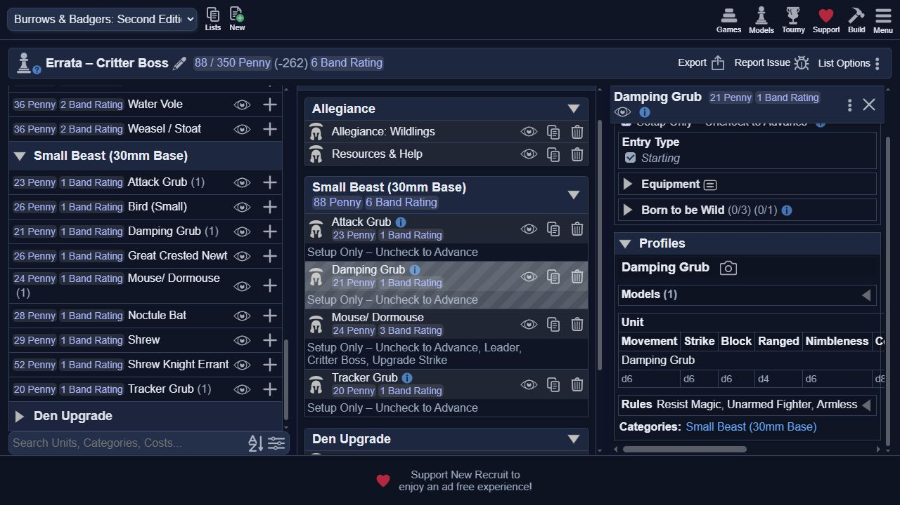
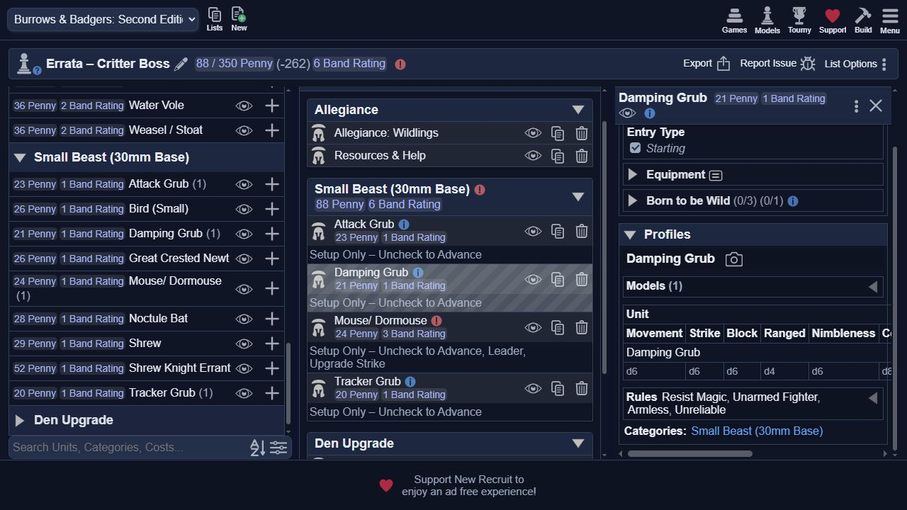
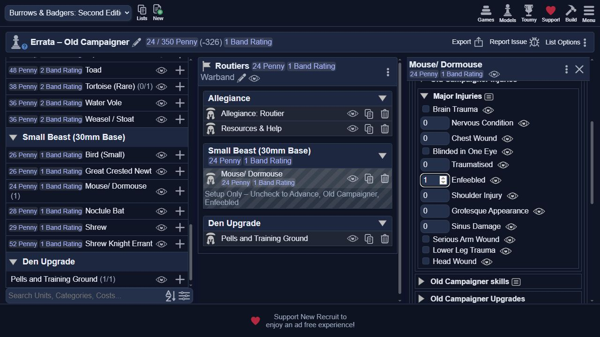
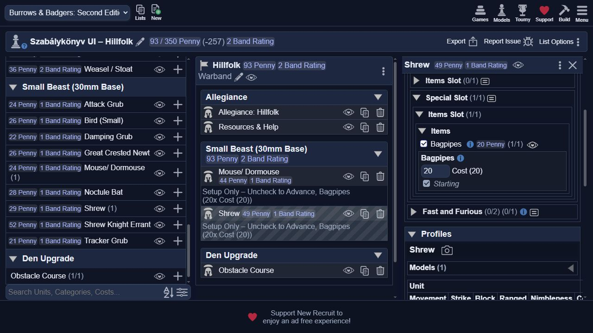
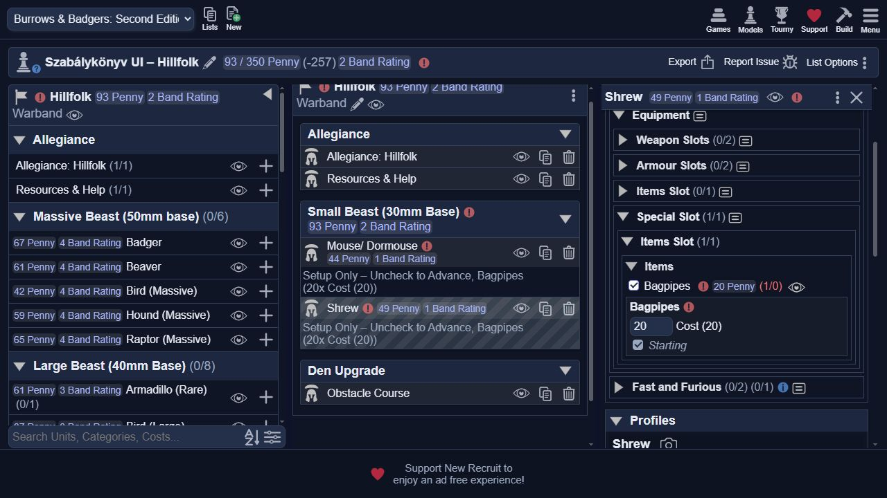

# Errata és frakciószabályok – New Recruit UI-próba

Dátum: 2026. október 17. Belső böngésző, külön Campaign TEST rendszer.
Első csomag: `8fdfcb6eb96185387955eb3d6b3184d8ca3ce7cb`, revision 11.
Végső csomag: `52dd85efc7306d91615230a6bcb5892086451d2c`, revision 12.
A csomagok csak a 12 külön azonosítós játékadat-fájlt tartalmazzák.
Import után teljes oldalváltással töltöttem újra a katalógusokat.

## Critter Boss – másik modellen, mindhárom Grubra

Próbalista: `Errata – Critter Boss`, Wildlings.
Három Grub, külön Mouse/Dormouse vezető; a vezető ingyenes Skillje a Critter Boss,
ingyenes statja Strike. A Grubok saját modelljén nincs Critter Boss.

| Modell | Critter Boss nélkül | Egér vezetőn bekapcsolva | Kikapcsolás után |
|---|---|---|---|
| Tracker Grub | Armless, Bloodhound, Unarmed Fighter, **Unreliable** | Armless, Bloodhound, Unarmed Fighter | **Unreliable visszatér** |
| Attack Grub | **Unreliable**, Unarmed Fighter, Armless | Unarmed Fighter, Armless | **Unreliable visszatér** |
| Damping Grub | Resist Magic, Unarmed Fighter, Armless, **Unreliable** | Resist Magic, Unarmed Fighter, Armless | **Unreliable visszatér** |

A táblázat tényleges DOM-profilmegfigyelés. Mind a négy megszerzési útvonalat
(reguláris fejlődés, Old Campaigner, Stable Ghast, tiszti ingyen Skill) az XML-teszt
ellenőrzi; a böngészőben ezek közül a tiszti útvonalat jártam be.
Az élő Undead Unreliable linkjének érintetlensége statikus ellenőrzés, nem külön UI-próba.
A végső fixture a visszaállási próba miatt kikapcsolt Boss-szal maradt.

## Old Campaigner – Enfeebled

Próbalista: `Errata – Old Campaigner`, Routiers.
Új Mouse/Dormouse: Level 1, Strong/Weak/Tough/Delicate nélkül.
Old Campaigner → Old Campaigner injuries → Major Injuries → Enfeebled mennyiség 1.

Eredmény: a profil **Weak(1)** képességet kapott, **Delicate nem jelent meg**,
a Level továbbra is **1**, a Band Rating **1**, a Penny költség továbbra is **24**.
Az XML ellenőrzi, hogy az Old Campaigner útvonalon nincs Level-csökkentés és
Pensiont kiváltó Level Down kategória. A normál sérülés útvonala megőrzi ezeket.
A Pensiont a kezdő UI külön nem mutatja, ezért a Pension-rész statikus bizonyíték.

A megjelenő közös sérülésleírás általános Level/Pension mondatai alól a Routiers
frakciószabály kivételt tesz; a számszerű módosítók ezt követik.

## Hillfolk – dudáslimit eltérő slotokból

Próbalista: `Szabálykönyv UI – Hillfolk`.
Az eredeti egér normál Items Slotjában már volt egy 20 Penny-s Bagpipes.
Egy teszt-Shrew Special Slot → Items Slot → Items útvonalán felvettem még egyet.

- **Előtte, revision 11:** két modellnél Bagpipes, összesen 93 Penny,
  a második választó `(1/1)`, semmilyen dudáslimit-hiba.
- **Utána, revision 12, ugyanaz a mentett lista:** mindkét érintett útvonalra
  `Roster has 1 selections too many of Bagpipes (max 0)`; a Shrew választó `(1/0)`.
  A másik slot foglalása miatt itt a megengedett darabszám 0.
- A teszt-Shrew dudáját levéve a hibák eltűntek, az eredeti egér dudája megmaradt,
  az összköltség 73 Penny lett. A Shrew tesztmodell megmaradt a próbalistában.

A négy slotmásolat mind a 12 eltérő párját automatizált teszt is ellenőrzi.
A böngészőben a normál Items és a Special Slot/Items kombinációját próbáltam.

## Visszakötött szabályok

A végső csomagban megnyitottam a meglévő két tesztlista Allegiance profilját:

- `Szabálykönyv UI – Routiers`: a Rules sorban megjelenik
  `Support Quests – Protect your Assets`.
- `Szabálykönyv UI – Undead`: a Rules sorban megjelenik `Upkeep`.

A változás a szabály megjelenítése; a Fate/XP és az ellátás kezelése kézi marad.

## Audit során felületen is igazolt megmaradó hiány

`Szabálykönyv UI – Arcane Conclave`: az egér Magic User választása mellett
Natural archetype-ot jelöltem. A korábbi Magic User minimumhiba eltűnt, miközben
Haste, Curse, Cure, Luck, Lightning és Push mind jelöletlen maradt. A lista nem
jelzett hiányzó kezdő Spellt. Ez alátámasztja a Magical Studies validációs hiányát.
A próbalistán a Natural archetype megmaradt, Spell nélkül.

A további frakciós/közös rések XML-ből és a szabálykönyvből következnek;
nem állítom, hogy mindegyikhez készült külön böngészős reprodukció.
A teljes frakciós eredmény: [implementációs audit](faction-implementation-audit-2026-10-17.md).
A tömörített DOM-bizonyíték: [observations.json](errata-ui-evidence/observations.json).

A 49 regressziós tesztcsoport sikeres. A próbacsapatok célzott fixture-ök,
nem kész, minden alapítási szabályt teljesítő warbandek.
