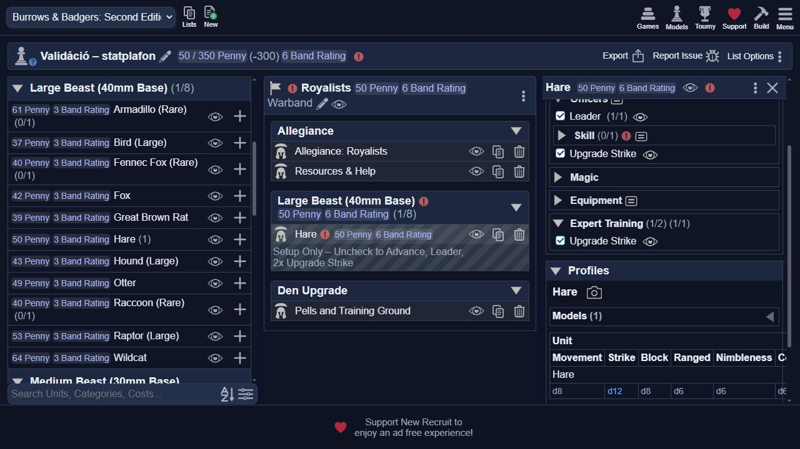
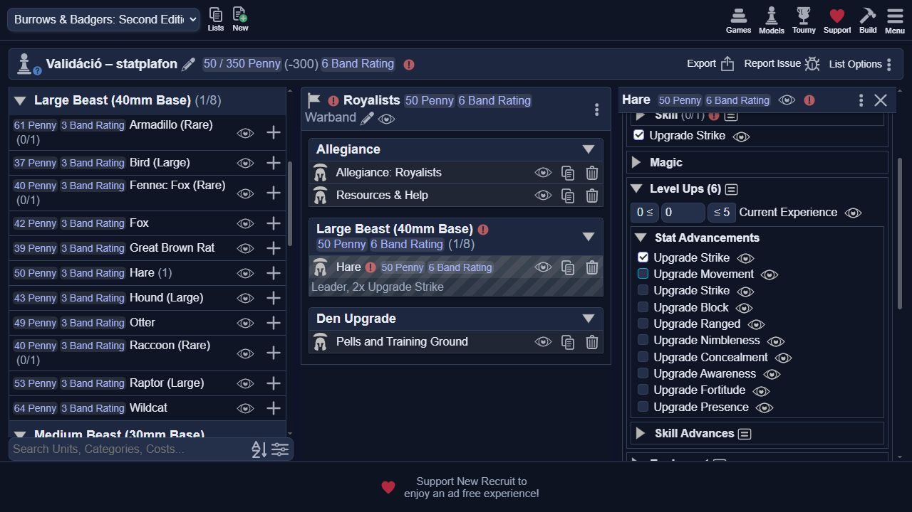
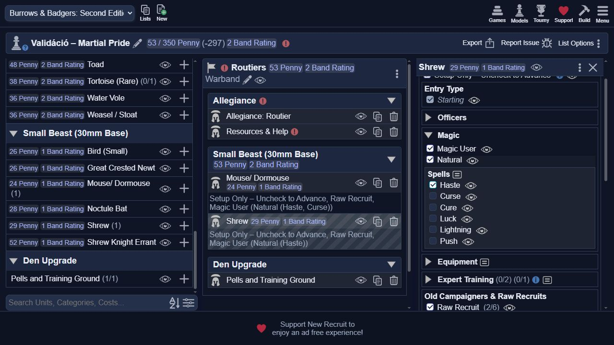
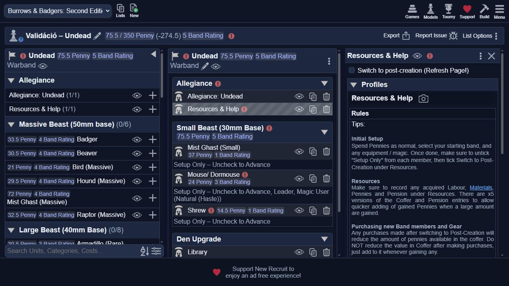
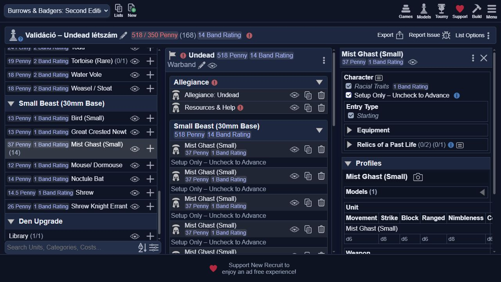

# Frakciók listavalidációja – megvalósítás és elfogadási próbák

A felhasználó kérésére a kész faj/errata javítások PR #32-ben masterre kerültek
(`a25f84e550c1e30fcbcf4223c116ee18cab355c6`). A hiányok három subagent munkájával,
egy `feature/faction-rule-validation` ágra gyűjtve készültek el.
A követelmények: [specifikáció](faction-rule-validation-spec.md).

## Eredmény

A korábbi auditban felsorolt, listában kifejezhető hiányok mindegyike ellenőrzést
kapott. Mind a tíz frakció eléri a kötelező Resources & Help bejegyzést, amely a
csapatszintű hibákat jelzi. A korábbi audit történeti állapot, nem a mostani hiánylista.

| Szabály | Megvalósítás |
|---|---|
| Új csapat minimum2 modell | Resources & Help hiba; POST után a kezdő minimum nem érvényes |
| Maximum10, Undead maximum13 | Modellek darabszáma, folyamatosan; nem Band Rating vagy upgrade-darabszám |
| Large8 / Massive6 | Mind a tíz frakció primary méretkategóriája, Freebeasts kiegészítve |
| Kezdő felszerelés vagy Spell | 447 valódi felszerelésútvonal vagy tényleges tanult Spell |
| Mist/Raw/Armless esetek | Mist saját fegyvere teljesít; Raw ingyenes valódi tárgyai teljesítenek; Armless Grubnak tárgy/páncél kell |
| Kezdő d12 statplafon | 151 kezdő statútvonal összeadódó ellenőrzése; fölös emelés hiba; profil nem ugrik d20-ra |
| Kampányfejlődés | A 108 normál statemelés d20 lehetősége megmarad |
| Arcane Magical Studies | Alapításkor modellenként legalább1 tényleges Spell |
| Routiers Martial Pride | Legfeljebb1 varázslómodell; egy modell sok Spellel is egyetlen mágus |
| Undead Restless Spirits | Legalább ceil(modellek/2) Mist a megengedett 1–13 modellre; 13 fölött külön maximumhiba |
| Undead tisztek | Az adott Leader/Second tényleges Spellje vagy Stable állapota kell |
| Stable Leader csapata | Csak Stable/Mist tagok; Stable Second önmagában nem tilt élő tagot |
| Undead élők ára/Unreliable | Puszta kapcsoló/archetype mellett félár és Unreliable; tényleges Spell mellett normál ár, Unreliable nélkül |
| Freebeasts/Rogues Resources & Help | A két frakció helyi Allegiance-kategórialinkje a közös kategóriára mutat; régi ID-k megmaradnak |

A varázslóvizsgálat a 36 kezdő/advance/tome Spell-csoport 204 tényleges
Spell-választását jelöli. A Magic User, Gifted vagy egy archetype önmagában nem Spell.
A segédkategóriák nem változtatják meg az állatok primary méretcsoportját.

A statplafon a kezdő statemelések kapacitását ellenőrzi. Raw Recruit Fortitude és
Presence csökkentése egy további lépést hagy, kivéve a d4 faji alapérték FAQ-padlóját.
Az Old Campaigner sérülést nem tekintjük további ingyenes statemelésre váltható
kapacitásnak: a 59. oldal előbb írja elő a d12-ig engedett választást, majd a hozzá
kötelező sérülést. Ez a választási sorrend értelmezése, nem új sérülésszabály.

## Automatizált ellenőrzés

`python -B -X utf8 -m unittest discover -s tests -q`: **68 sikeres tesztcsoport**.
A teljes eredeti 49 csoport megmaradt, 19 új csoport ellenőrzi a határértékeket,
scoped feltételeket, kombinált statbónuszokat és mind a tíz frakció hozzáférését.
A régi Undead tesztek kapcsoló helyett valódi Spell-kontextust használnak.

A rögzített master alap minden eredeti azonosítója megmaradt; a 49 Unit profil
alapértékei változatlanok. A végső staging 12 fájl, 8605 elkülönített azonosító;
XML-parse, duplikált ID, feloldatlan target és eredeti ID kiszivárgás ellenőrizve.

## Valódi New Recruit-próbák

A belső böngésző a külön Campaign TEST rendszert használja. A tesztek célzott
fixture-ök; más, szándékosan hiányzó felszerelés vagy tiszti Skill, illetve a keret
átlépése külön hibát okozhat. A táblázat mindig az adott ellenőrzés eredményét állítja.

| Próba | Megfigyelt eredmény |
|---|---|
| Royalists 11→10 modell | 11-nél maximumhiba, 10-re csökkentve eltűnik; POST fázisban is érvényes |
| Új Royalists 0/1/2 modell | 0 és1 minimumhiba, 2-nél nincs minimumhiba |
| Egy modell POST fázisban | A kezdő minimumhiba megszűnik |
| Undead 13/14 Mist | 13-nál nincs létszámhiba; 14-nél maximum13 hiba; 13-ra visszavéve eltűnik |
| Freebeasts Large8/9 és Massive6/7 | 9 Large és7 Massive külön méretkorláthibát ad; a küszöbön még nincs adott mérethiba |
| Arcane Natural, 0→1 Haste | Archetype önmagában Magical Studies hiba; tényleges Haste után eltűnik |
| Routier 1 modell 2 Spell | Nincs Martial Pride hiba |
| Második Routier archetype / Spell | Archetype önmagában nem második mágus; Haste választása maximum1 hibát ad, levétele feloldja |
| Undead 1 Mist /3 modell | Restless Spirits hiba; 2 Mist /3 modell mellett nincs ilyen hiba |
| Undead élő egér vezető | Spell nélkül jogosultsági hiba és12 Penny; Haste után nincs tiszti hiba,24 Penny |
| Stable vezető + élő tag | Összetételi hiba; élő tag eltávolításával eltűnik |
| Stable Second + élő tag | Nincs Stable Leader összetételi hiba; Otherworldly visszatér |
| Stable vezető Spell nélkül | Tiszti jogosultság megmarad; Otherworldly nem jelenik meg |
| Hare Leader Strike + Expert Training | Egy emeléssel d12; kettővel d12 marad és statplafonhiba; fölös emelés levételével hiba eltűnik |
| Ugyanaz a Hare kampányadvance | Kezdő setup kikapcsolása után rendes Upgrade Strike d20-ra emel, plafonhiba nélkül |
| Raw Recruit ingyen fegyver | Egykezes fegyver + Free item: Shrew29 Penny marad, a felszerelési minimum teljesül |
| Tracker Grub páncél | Felszerelés nélkül minimumhiba; Light armour kiválasztásával e modell hibája eltűnik |

A kezdeti force másodlagos, rejtett kategóriájára tett korlátokat a New Recruit
nem jelezte. Ezért a csapatszintű szabályok a kötelező Resources & Help közvetlen
hibaüzenetei. A primary méretkategóriák korlátai működnek. A tesztben a Freebeasts
és Rogues eltérő helyi Allegiance-kategóriája is kiderült és javítva lett.

Végső UI-csomag: revision16, tesztág `test/faction-rulebook-ui-20261017`,
commit `f0c04e6b746512999011a85a7269ad0095e4c864`.
Korábbi próbák revision14/15-tel is készültek; a helyi stat/Spell/felszerelés
logika ezekben azonos, a végső változás a két frakció Resources-hozzáférése.

A végső revision16 import után új Freebeasts és Rogues listát is létrehoztam:
Resources & Help mindkettőn automatikusan bekerült, az üres csapat minimum2 hibát
jelzett. A régi, Resources nélküli Freebeasts méretfixture-ön a bejegyzés már
elérhető: egyszer hozzáadva a korábbi hiányzó-Resources hiba megszűnt, és a
16 modellre a globális maximum10 hiba is megjelent. Meglévő ilyen mentésnél
a Resources & Help egyszeri hozzáadása szükséges lehet.

A [DOM-megfigyelések](validation-ui-evidence/observations.json) és a többi kép
ugyanebben a bizonyítékmappában van. [Két tengelyű review](faction-rule-validation-review.md).

## Kézzel követendő játékhatások

A Quest/Fate/XP jutalmak, dobások, fejlődési archetype-táblák, ideiglenes dudanóták,
harci/mágikus hatások és terepi távolságok továbbra is játékos által követendők.
Ezeknek a szabályszövege elérhető; a listakatalógus nem játékmotor.
A sikeres ellenőrzés a specifikáció listában kifejezhető követelményeit fedi le,
nem a teljes szabálykönyv valamennyi játékszituációjának automatikus kezelését.
