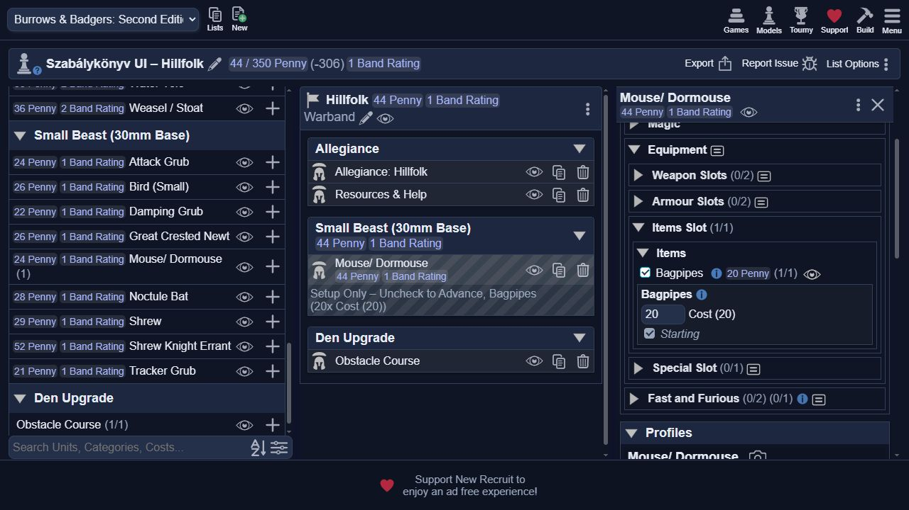
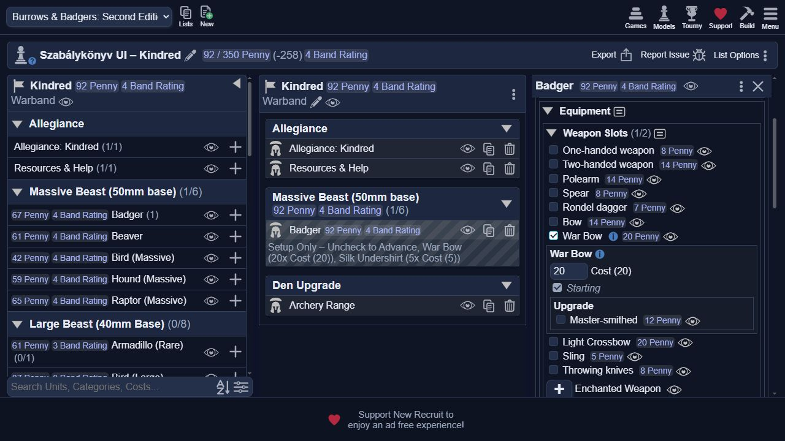
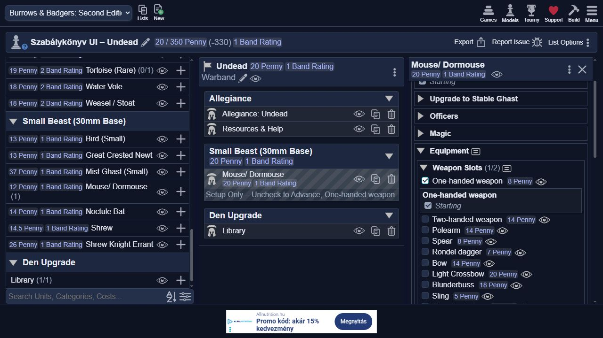
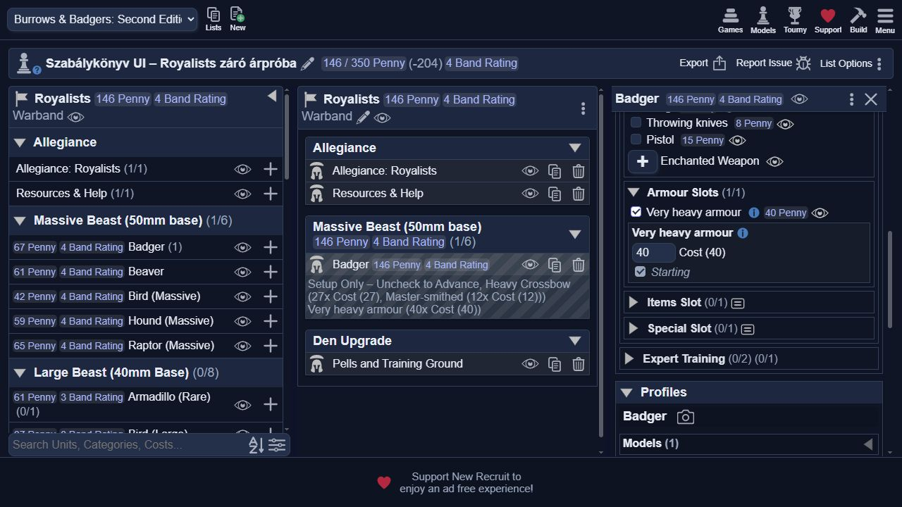
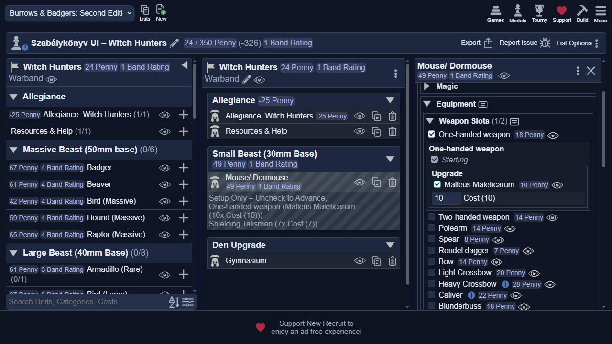
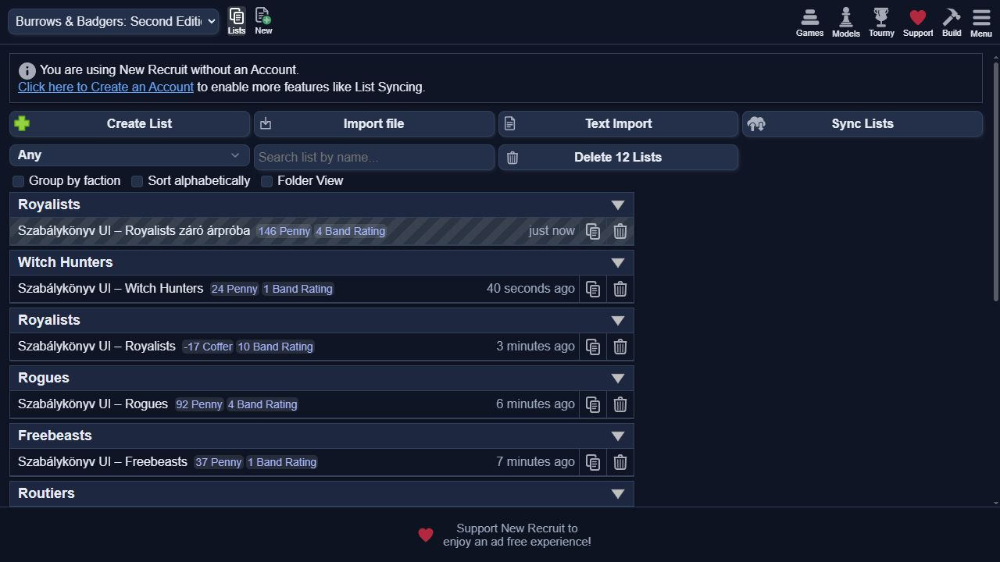

# New Recruit felületi teszt – frakciós szabálykönyvi javítások

Dátum: 2026. október 17. Felület: `https://www.newrecruit.eu`, Codex belső böngésző.
Az ellenőrzések valódi gombokkal, választókkal és listákkal történtek.
Az XML-kiértékelő nem helyettesítette a New Recruit motort.

## Import és azonosíthatóság

A `scripts/stage_campaign_test.py` által készített 12 adatfájl elkülönített,
`campaign-test-` előtagú azonosítókat használ. A forráskönyv és a dokumentáció
nem került a nyilvános tesztágra. A stabil rendszer külön telepítve maradt.

Tesztág: `test/faction-rulebook-ui-20261017`.
Végleges import: `8230d24cd9cb0fae1c246c94bc665e0ae5622d33`.
[Rögzített tesztverzió telepítése](https://www.newrecruit.eu/app/MySystems?addSystem=Westy661%2FBurrows-Badgers-Second-Edition&ref=8230d24cd9cb0fae1c246c94bc665e0ae5622d33).

Minden frakcióhoz `Szabálykönyv UI – <frakció>` nevű tesztlista készült.
Ezek kis, célzott próbák, nem teljes, versenyre szabályos csapatok.
A kiválasztott Stable Ghast még kéri a jogos stat- és skillfejlesztést;
az elégtelen kampánypénz szándékosan előállított állapotban hibaüzenetet ad.

## Megfigyelt eredmények

| Frakció | Felületen elvégzett próba és eredmény |
| --- | --- |
| Wildlings | Attack Grub 23, Damping Grub 21, Mouse 24: összesen 68 Penny. Mortal Poison egy adaggal 73, három adaggal 83; a Mouse 39 Penny. Critterek: 32/23/20/23/23. Silk és Telescope nem szerepel a kezdő Item kínálatban. |
| Hillfolk | Mouse 24; critterek 30/23/20/23/23. Bagpipes 20 kiválasztva összesen 44; saját Bagpipes profil és Piper szabály jelenik meg. Relic, Mirror, Silk, Telescope és Old One Brews nincs a kezdő Item választékban. |
| Witch Hunters | Bonded Beetle Grub megjelenik 25 Pennyért. Shielding Talisman 7; a saját, első sikeres ellenséges varázslatot elnyelő profilját mutatja. Mouse 24 + Talisman 7 - 25 Well-funded bónusz = 6 összesített Penny. A végleges importban One-handed weapon 8 + Malleus 10 hozzáadásával 24, a felármező `Cost (10)`. |
| Kindred | Badger 67 + Armour helyen felvett Silk Undershirt 5 + War Bow 20 = 92 Penny. Armour Slots 1/2, Heavy Shield nincs az opciók között. Expert Training kerete 3. |
| Undead | Élő Mouse 12 és Unreliable; normál fegyverrel 20. Stable Ghastként 24+15+8=47, Unreliable eltűnik. Small Mist Ghast 37, Level 1, nincs Officers csoport. Medium 37, Level 2, 2 Band Rating. Az ingyenes fegyverprofil az újraimportált javítás után egyszer jelenik meg. |
| Arcane Conclave | Mouse 24 + Mirroring Talisman 13 = 37. A Cost mező számmal 13, és saját Mirroring profil jelenik meg. Arcane Tome kezdőára 17, Shielding Talisman 10. |
| Routiers | Small Bird Raw Recruit Fortitude és Presence d4 marad. One-handed weapon + Free item mellett az összeg 26. Kampányváltáskor a kezdő modell és fegyver nem terheli a kasszát. Új Small Bird 26-ot von le; ingyenes fegyverrel a kassza változatlan. |
| Royalists | Heavy Crossbow újraválasztva 27, Master-smithed felár 12, Very heavy armour 40: Badgerrel összesen 146. A hibás, 28-as korai tesztadat helyett az új alapértelmezés 27. Mirroring Talisman és Old One Brews nincs a kezdő Item kínálatban. A végleges import friss záró listáján is 27/12/40, összesen 146; a felárcímke `Cost (12)`. |
| Rogues | Badger 67 + Caliver 25 = 92. Telescope 10 és Silk 5 elérhető; Mirroring Talisman, Relic és Old One Brews nincs a kezdő Item kínálatban. |
| Freebeasts | Shrew Knight Errant Level 1. Telescope 10 kiválasztva a Cost mező is 10; összesen 52+10-25=37 Penny. Arcane Tome 20, Mirroring 10, Shielding 7; Old One Brews nincs a kezdő Item kínálatban. |

## Kampány és előfeltételek

- Undead: 50 Cofferből az új Shrew félára, 14,5 levonva 35,5 marad.
  Stable Ghasttá alakítva a teljes 29+15=44 kerül levonásra, a maradék 6.
  A korábbi kezdő modellek és tárgyak nem csökkentik a kampánykasszát.
- Routiers: 50 Cofferből az új Small Bird után 24 marad. Fegyverrel 16,
  Free item kiválasztásával újra 24. A fegyver nem terhelődik kétszer.
- Royalists: a 146 Pennyért összeállított kezdő Badger és tárgyai kampányváltáskor
  nulla Coffer terhelést adnak. Az új Badger 67-et von le; az új War Bow
  `Cost (3d6+8)` mezővel, 0 kezdeti összeggel indul, nem fix 20-szal.
- Spell Breaker: kiválasztás előtt nincs előfeltételhiba. Kiválasztva Resist Magic
  nélkül megjelenik a hiba; Resist Magic hozzáadásával eltűnik.

## A felületi körből visszajavított hibák

1. Dupla Mist Ghast fegyverprofil: az automatikus ingyenes fegyver mellé nem kell külön infoLink.
2. Ismételt XML `conditions` konténerek: a motor másként olvasta őket, mint a saját tesztsegéd.
3. Rejtett fő Telescope és egy Very heavy armour ármező.
4. Kiválasztás nélkül jelzett Spell Breaker előfeltételhiba, mind a négy tanulási útvonalon.
5. Elavult méregárazási súgó és dobást mutató fix kezdő fegyverfelár-címkék.

## Korlátok

A teljes 49 faj × minden tárgy × minden frakció kombináció felületi végigkattintása
nem történt meg. Ezek széles lefedését a könyvből rögzített elvárt adatok és a
27 szabálykönyvi tesztcsoport adják, a 14 korábbi teszt mellett.
Az automatikusan ki nem kényszerített csapatösszetételi szabályokat az
[adatellenőrzési jelentés](faction-rulebook-audit-2026-10-17.md) sorolja fel.

A már mentett változóárú tárgy darabszámként tárolt ára nem változik át magától
új alapértelmezésre. A korai Royalists tesztben a 28-as mező megmaradt,
majd újraválasztás után 27-re állt. Valódi korábbi listán a kézzel rögzített
ármezőt ellenőrizni kell. Import után teljes oldalfrissítés szükséges.

## Képernyőképek

