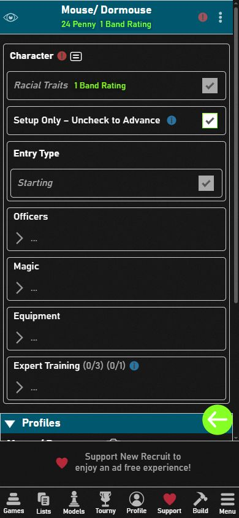
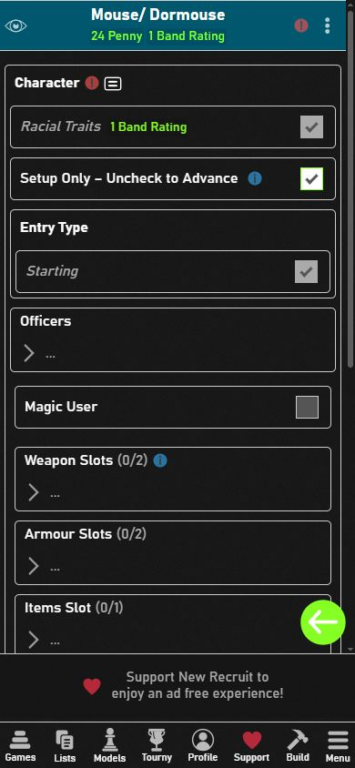

# New Recruit mobilos csoportok – megjelenítési próba

2026-10-18, New Recruit 36.49, Chrome, 390 × 844 px.

## Eredmény

A nagy, üres `…` sorokat a **Menu → Options → General → Use big interface** beállítás kikapcsolása megszünteti. A normál, változatlan játékcsomaggal a Magic és Equipment újra keskeny, egysoros, nyitható fejléc. Ehhez nem szükséges új játékadat-kiadás. A beállítást azon a böngészőn/eszközön kell ellenőrizni, ahol a nagy felület látszik.

## Azonos karakteres összehasonlítás

Mindkét kép ugyanazon normál rendszerű Kindred Mouse / Dormouse tesztkarakterről készült, kezdő felszerelés nélkül. A két jelzett szabályhiba a szándékosan hiányos egyfős tesztlista következménye, nem a megjelenítési próba hibája. A meglévő teszt és Brigands listákat nem módosítottuk.

| Előtte: nagy felület | Utána: kompakt felület |
| --- | --- |
|  |  |

## Elvetett adatfájl-próbák

1. A Magic és Equipment `collapsible=false` beállítása: a Magic User rögtön látszott, de az Equipment mobilos almenüje változatlan maradt.
2. A két külső csoport `flatten=true` beállítása: az Equipment helyett rögtön a Weapon / Armour / Items / Special Slots sorok jelentek meg, ugyanolyan nagy üres blokkokkal. Ez hosszabbá tette a karakterlapot.

Az elkülönített Campaign TEST csomag két adatpróbája a meglévő `test/faction-rulebook-ui-20261017` ágra került: `fb02dced106a9a9050ab12a87e86703581b45f8f` és `d96337fb87a58918e4b787e42358311fc68f51bf`. A normál master/release csomag nem módosult. A megjelenítési adatpróbát a munkapéldányban is visszavontuk. Az első kétattribútumos próbán a meglévő 91 teszt sikeres volt; a felületi eredményt valódi New Recruit screenshotok igazolják.
