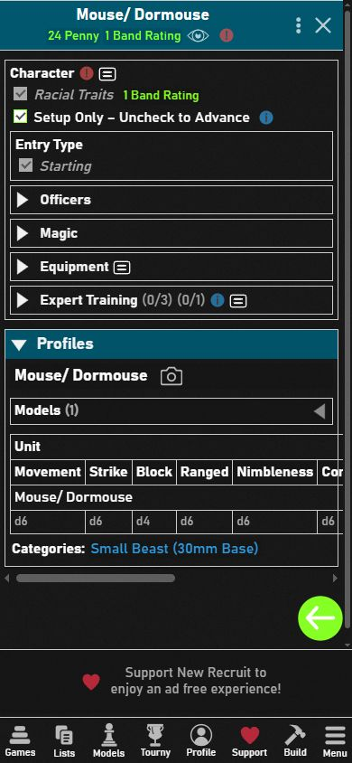
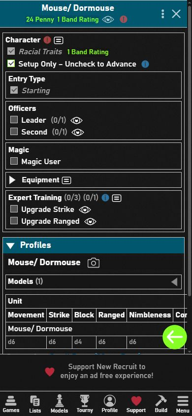
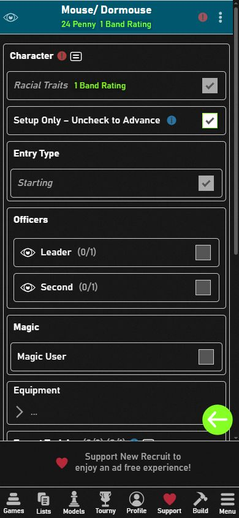

# Rövid választások közvetlen megjelenítése – revision 22

2026-10-18. A nagy mobilos nézet üres `…` sorait a külön [megjelenítési próba](mobile-group-layout-2026-10-18.md) vizsgálta. Ez a változás a ténylegesen felesleges összecsukást csökkenti a kompakt és a nagy felületen is.

## Eredmény

13 meglévő csoport `collapsible` jelzője változik `true` értékről `false` értékre: tíz kezdőbónusz-változat, továbbá Officers, Magic és Upgrade to Stable Ghast. A karakterlap közvetlenül mutatja a rövid kezdőválasztásokat, a Leader/Second és Magic User opciót, valamint ahol elérhető, a Stable Ghast választást. A frakció-, kampány- és egyéb megjelenési feltételek változatlanok, ezért csak az adott karakterre érvényes bónusz látszik. A Relics of a Past Life kilenc statja is közvetlenül megjelenik: ez kezdéskor kiválasztandó bónusz, nem egy hosszú opcionális katalógus.

Az Equipment, fegyverek, páncélok, tárgyak, sérülések, hat készségcsalád és hasonló hosszabb listák összecsukása megmarad. Az Equipment külső keretének elhagyása a korábbi próbában több hosszú menüsort tett a főlapra; ezt nem emeljük át. A szabályokhoz szükséges logikai csoportokat nem töröljük.

## Felületi bizonyíték

Chrome, New Recruit 36.49, 390 × 844 px; az elkülönített Campaign TEST csomag tesztcommitja: `febfe77b5d3f1bf95067755e1cc5f91f9ff71c2e`. A normál és a tesztrendszer külön azonosítókat használ. A korábbi felhasználói listákat nem módosítottuk.

| Kompakt nézet előtte | Kompakt nézet utána |
| --- | --- |
|  |  |

A Kindred Mouse / Dormouse tesztkarakteren a Leader, Second, Magic User, Upgrade Strike és Upgrade Ranged külön menünyitás nélkül látszott mindkét mobilos felületen és asztali nézetben. A Strike bónusz bepipálása d6 → d8 változást okozott, a kiválasztott bónusz 1/1 korlátja továbbra is működött; visszavonás után d6 állt vissza. A Leader választás megjelenítette a kötelező tiszti stat- és készségválasztásokat, valamint azok hiányának hibajelzését. A Magic User választás megjelenítette az engedélyezett archetype-okat. A próbaválasztásokat visszavontuk. A hiányos, egyfős tesztlista felszerelés- és létszámhibája várható.

A további frakciós bónuszok és a Stable Ghast változat megjelenítési attribútumát strukturálisan ellenőriztük; nem állítjuk, hogy mind a 13 változat külön UI-próbát kapott. Az XML szemantikai összehasonlítása pontosan a 13 `collapsible` jelzőt és a 19 → 22 rendszer-revíziót mutatta eltérésként; minden szabály, ár, stat, feltétel, korlát és azonosító azonos. A 20/21 revízió két korábbi elkülönített megjelenítési próbához tartozott.

## Az összecsukható csoportok leltára

Az adatcsomagban 54 csoport rendelkezett kifejezett `collapsible=true` jelzővel, mind a közös rendszerfájlban. Ebből 13 lesz nyitott, 41 marad összecsukható. A New Recruit saját, beágyazásból következő mobilos almenüi nem mind vezérelhetők ezzel az attribútummal.

| Csoportnév | Korábbi összecsukható változatok | Közvetlenül megjelenik | Összecsukható marad |
| --- | ---: | ---: | ---: |
| Armour Slots | 4 | 0 | 4 |
| Armoured by Faith | 1 | 1 | 0 |
| Bonded critters | 4 | 0 | 4 |
| Born to be Wild | 1 | 1 | 0 |
| Equipment | 1 | 0 | 1 |
| Expert Training | 3 | 3 | 0 |
| Fast and Furious | 1 | 1 | 0 |
| Injuries | 1 | 0 | 1 |
| Items | 4 | 0 | 4 |
| Items Slot | 4 | 0 | 4 |
| Magic | 1 | 1 | 0 |
| Mental Prowess | 1 | 1 | 0 |
| Officers | 1 | 1 | 0 |
| Old Campaigner injuries | 1 | 0 | 1 |
| Old Campaigner skills | 1 | 0 | 1 |
| One to Watch | 1 | 1 | 0 |
| Poison | 4 | 0 | 4 |
| Quick and Quiet | 1 | 1 | 0 |
| Relics of a Past Life | 1 | 1 | 0 |
| Skill | 2 | 0 | 2 |
| Skill Advances | 1 | 0 | 1 |
| Special Slot | 3 | 0 | 3 |
| Special ammunition | 4 | 0 | 4 |
| Spells | 1 | 0 | 1 |
| Stat | 2 | 0 | 2 |
| Upgrade to Stable Ghast | 1 | 1 | 0 |
| Weapon Slots | 4 | 0 | 4 |

## Módosított csoportazonosítók

| Csoport | Megőrzött azonosító |
| --- | --- |
| Magic | `05f1-11ff-c43f-4767` |
| Expert Training | `def0-c21c-1cd9-aa3e` |
| Quick and Quiet | `d5ca-8c03-982f-67bc` |
| One to Watch | `6962-4616-5c5f-7f50` |
| Armoured by Faith | `3a58-b3a5-04c3-6f27` |
| Born to be Wild | `0a18-93b1-3ba9-6c5a` |
| Mental Prowess | `4a36-a072-5d2b-efa8` |
| Relics of a Past Life | `63de-4a13-bb54-eac6` |
| Fast and Furious | `02f4-30ec-62ca-0ce3` |
| Expert Training | `edd0-09cf-c745-57b4` |
| Expert Training | `f123-f107-5267-9028` |
| Upgrade to Stable Ghast | `6966-e959-0325-a903` |
| Officers | `5448-d2e6-7baa-f8c2` |

## Ellenőrzés

- `python -B -X utf8 -m unittest discover -s tests -q`: 91 teszt sikeres.
- A kiinduló XML és a módosított XML rekurzív összehasonlítása: csak a 13 megjelenítési jelző és a revízió változott.
- Elkülönített csomaggenerálás: 12 játékadatfájl, 8605 megőrzött/remappelt azonosító, ismétlődés és feloldatlan hivatkozás nélkül.
- Új, kizárólag attribútumértéket visszaellenőrző teszt nem készült; a meglévő szabálytesztek és a valódi felületi próba adják az ellenőrzést.
