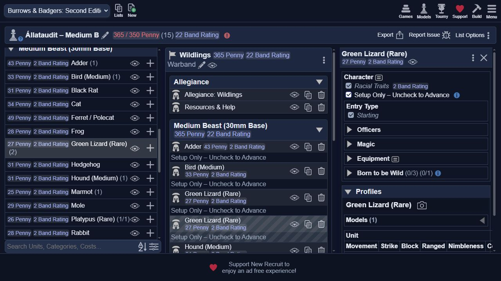
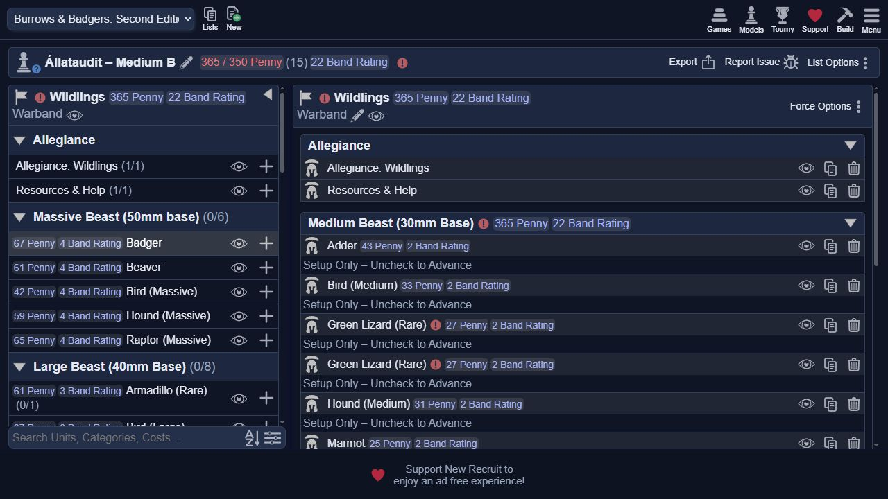
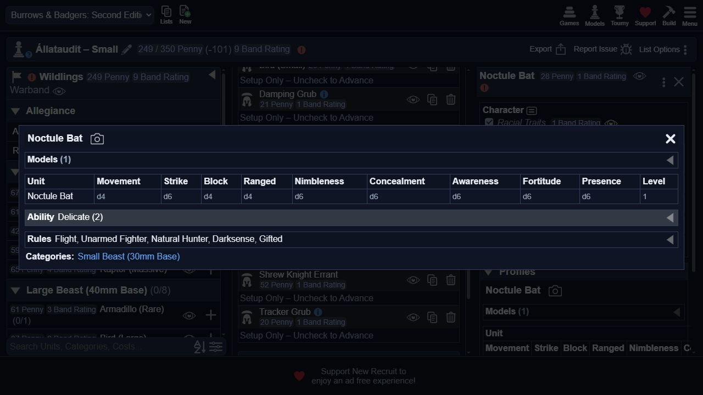
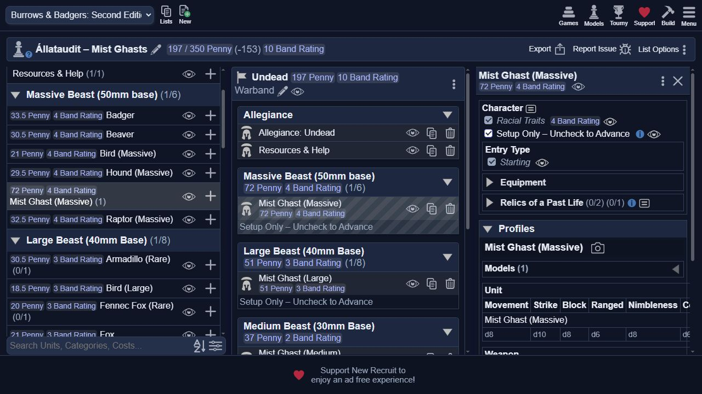

# Az összes állatválasztás és alapstat ellenőrzése

Dátum: 2026. október 17. Alap: master `63a2e82`, a merge-elt #31 PR után.
Javítási ág: `fix/species-stats-audit`. A közös rendszer új revision értéke **10**.

## Eredmény

- Mind a **49 fajváltozat** megvan. Nincs hiányzó vagy váratlan további Unit profil.
- **490/490** alap stat- és Level-érték egyezik a könyvvel és a hivatalos erratával.
- **147/147** Strong/Tough/Delicate érték és **49/49** veleszületett traitlista egyezik.
- Az összes fajt egyenként felvettük a New Recruit tesztlistáiba, és a ténylegesen
  megjelenő profilokat olvastuk vissza a belső böngészőben. Ezek a számok tehát
  nem csupán az XML és a saját tesztadatok egyezését jelentik.
- Egy új választási hiba javult: a **Green Lizard (Rare)** nem kapta meg a ritka
  fajok egy példányos korlátját és Rare kategóriáját. A másik hat ritka fajnál ezek megvoltak.
- Alapstatot ebben a javításban nem kellett módosítani. Mind a 49 Unit profil
  byte szerinti XML-összevetése is változatlan a #31 utáni masterhez képest.

## Források és módszer

- Helyi második kiadású könyv: `../Burrows__Badgers_Osprey_Games_Second_Edition_Rulebook_OEF_2025.pdf`.
  A 43–46. nyomtatott oldalak fajlistáit teljes oldalas képen és szövegként is újraolvastuk.
  A ritka fajok legfeljebb egyszer vehetők: 41. oldal, Band Creation Summary 5. pont.
- [Hivatalos FAQ/errata, 2025. május 16.](https://www.burrowsandbadgers.com/downloads/burrows%26badgers-faq-2025.pdf), az ellenőrzés napján frissen lekérve.
  A Medium Mist Ghast Level 2, a Small Level 1, bár a könyv közös sora 1-et ír.
  A Green Lizard és a Siamese Cat nem kap hiányzó kezdő skillt.
  A Grubok Unreliable képessége a 115. oldal és az FAQ alapján része az ellenőrzésnek.
- A táblázati névváltozatok a teljes szabálynevekhez igazodnak:
  Mole: Short-Sighted; Adder: Poisonous; Armadillo: a táblázat „Leap” szava Leaperként értelmezett.
- A FAQ szerint minden állat 16 Wounds értékkel játszik. Ez közös állandó,
  nem a fajonként eltérő kilenc dobókockás stat egyike.
- A Noctule Bat Gifted képességéhez mágikus archetipust kell választani
  (Gifted leírás, 137. oldal); az ezt kérő jelzés a puszta profiltesztben jogos.

A széles statpróba a revision 9-es, #31-gyel egyező importot használta:
`8230d24cd9cb0fae1c246c94bc665e0ae5622d33`.
A revision 10 csak a Green Lizard választási metaadatait változtatja;
a két példányos hiba visszatesztje már a javított csomaggal történt:
`39f5570a9e99a85efabc76d235ea34722d78b161`.
[A javított tesztcsomag telepítése](https://www.newrecruit.eu/app/MySystems?addSystem=Westy661%2FBurrows-Badgers-Second-Edition&ref=39f5570a9e99a85efabc76d235ea34722d78b161).

## Állatonkénti eredmény

Oszlopok: M Movement, S Strike, B Block, R Ranged, N Nimbleness,
C Concealment, A Awareness, F Fortitude, P Presence. Az ár a könyv szerinti
alap toborzási díj; a frakciós Grub-kezdőárak és Undead félár külön módosítók.
A nulla értékű Strong/Tough/Delicate képességeket nem soroljuk fel.
Minden sor **UI: OK** eredménye az adott állat tényleges felvételéből származik.

### Small – 30 mm

| Állat | M | S | B | R | N | C | A | F | P | Level | Alapár | Veleszületett képességek | UI |
|---|---|---|---|---|---|---|---|---|---|---|---|---|---|
| Mouse/ Dormouse | d6 | d6 | d4 | d6 | d6 | d6 | d6 | d6 | d6 | 1 | 24 | – | OK |
| Shrew | d6 | d6 | d6 | d6 | d6 | d6 | d6 | d8 | d6 | 1 | 29 | – | OK |
| Bird (Small) | d6 | d6 | d6 | d6 | d6 | d6 | d6 | d4 | d4 | 1 | 26 | Flight | OK |
| Noctule Bat | d4 | d6 | d4 | d4 | d6 | d6 | d6 | d6 | d6 | 1 | 28 | Delicate (2), Flight, Unarmed Fighter, Natural Hunter, Darksense, Gifted | OK |
| Great Crested Newt | d6 | d6 | d6 | d6 | d6 | d6 | d6 | d6 | d6 | 1 | 26 | Swim | OK |
| Shrew Knight Errant | d8 | d6 | d6 | d4 | d6 | d4 | d8 | d10 | d8 | 1 | 52 | Fighting Mount, Fearless | OK |
| Tracker Grub | d6 | d6 | d6 | d4 | d6 | d8 | d6 | d6 | d6 | 1 | 27 | Armless, Bloodhound, Unarmed Fighter, Unreliable | OK |
| Attack Grub | d6 | d6 | d6 | d4 | d6 | d8 | d6 | d6 | d6 | 1 | 28 | Strong (1), Unreliable, Unarmed Fighter, Armless | OK |
| Damping Grub | d6 | d6 | d6 | d4 | d6 | d8 | d6 | d6 | d6 | 1 | 25 | Resist Magic, Unarmed Fighter, Armless, Unreliable | OK |
| Mist Ghast (Small) | d6 | d8 | d6 | d6 | d8 | d6 | d10 | d6 | d6 | 1 | 37 | Otherworldly, Uncanny | OK |

### Medium – 30 mm

| Állat | M | S | B | R | N | C | A | F | P | Level | Alapár | Veleszületett képességek | UI |
|---|---|---|---|---|---|---|---|---|---|---|---|---|---|
| Hedgehog | d6 | d6 | d6 | d6 | d6 | d6 | d6 | d6 | d8 | 2 | 31 | Spines | OK |
| Squirrel | d6 | d6 | d6 | d6 | d8 | d8 | d8 | d8 | d6 | 2 | 42 | Climber | OK |
| Mole | d4 | d6 | d6 | d4 | d6 | d6 | d4 | d8 | d6 | 2 | 29 | Strong (1), Tunneller, Short-Sighted | OK |
| Weasel / Stoat | d8 | d8 | d6 | d6 | d8 | d6 | d6 | d6 | d6 | 2 | 36 | Fearless | OK |
| Black Rat | d6 | d8 | d6 | d6 | d6 | d8 | d6 | d6 | d6 | 2 | 31 | – | OK |
| Ferret / Polecat | d8 | d8 | d6 | d6 | d8 | d6 | d8 | d8 | d8 | 2 | 49 | Fearless | OK |
| Cat | d6 | d8 | d6 | d6 | d8 | d6 | d6 | d6 | d8 | 2 | 34 | – | OK |
| Rabbit | d8 | d6 | d6 | d6 | d6 | d6 | d6 | d6 | d6 | 2 | 28 | – | OK |
| Toad | d6 | d6 | d6 | d4 | d6 | d10 | d6 | d8 | d8 | 2 | 48 | Strong (1), Tough (2), Natural Hunter | OK |
| Frog | d6 | d6 | d6 | d6 | d6 | d6 | d6 | d6 | d6 | 2 | 28 | Leaper, Swim | OK |
| Adder | d6 | d8 | d4 | d4 | d4 | d8 | d8 | d8 | d8 | 2 | 43 | Poisonous, Unarmed Fighter, Armless | OK |
| Marmot | d6 | d6 | d6 | d6 | d6 | d4 | d6 | d6 | d6 | 2 | 25 | – | OK |
| Water Vole | d8 | d6 | d6 | d6 | d8 | d6 | d6 | d8 | d6 | 2 | 36 | Swim | OK |
| Bird (Medium) | d6 | d6 | d6 | d6 | d8 | d6 | d6 | d6 | d6 | 2 | 33 | Flight | OK |
| Raptor (Medium) | d6 | d8 | d6 | d4 | d8 | d6 | d8 | d6 | d6 | 2 | 43 | Strong (1), Flight, Unarmed Fighter, Natural Hunter | OK |
| Hound (Medium) | d6 | d8 | d6 | d6 | d6 | d4 | d6 | d6 | d6 | 2 | 31 | Strong (1) | OK |
| Green Lizard (Rare) | d6 | d6 | d4 | d6 | d6 | d8 | d6 | d6 | d6 | 2 | 27 | – | OK |
| Siamese Cat (Rare) | d6 | d8 | d6 | d6 | d6 | d6 | d6 | d8 | d8 | 2 | 36 | – | OK |
| Tortoise (Rare) | d4 | d8 | d6 | d6 | d6 | d6 | d6 | d6 | d6 | 2 | 38 | Tough (2) | OK |
| Platypus (Rare) | d6 | d6 | d4 | d6 | d6 | d6 | d6 | d6 | d6 | 2 | 26 | Swim | OK |
| Mist Ghast (Medium) | d6 | d8 | d6 | d6 | d8 | d6 | d10 | d6 | d6 | 2 | 37 | Otherworldly, Uncanny | OK |

### Large – 40 mm

| Állat | M | S | B | R | N | C | A | F | P | Level | Alapár | Veleszületett képességek | UI |
|---|---|---|---|---|---|---|---|---|---|---|---|---|---|
| Hare | d8 | d10 | d8 | d6 | d6 | d6 | d6 | d8 | d8 | 3 | 50 | Strong (1), Leaper | OK |
| Wildcat | d8 | d10 | d6 | d4 | d8 | d8 | d8 | d8 | d8 | 3 | 64 | Strong (2), Tough (1), Natural Hunter, Fearsome | OK |
| Great Brown Rat | d8 | d8 | d6 | d6 | d6 | d6 | d6 | d6 | d8 | 3 | 39 | Strong (1) | OK |
| Fox | d8 | d8 | d6 | d8 | d6 | d6 | d6 | d6 | d8 | 3 | 42 | Strong (1) | OK |
| Otter | d8 | d8 | d6 | d8 | d8 | d6 | d6 | d8 | d8 | 3 | 49 | Strong (1), Swim | OK |
| Bird (Large) | d6 | d6 | d6 | d6 | d8 | d4 | d6 | d8 | d6 | 3 | 37 | Flight | OK |
| Raptor (Large) | d6 | d8 | d6 | d4 | d8 | d4 | d8 | d8 | d8 | 3 | 53 | Strong (2), Flight, Unarmed Fighter, Natural Hunter | OK |
| Hound (Large) | d6 | d8 | d6 | d6 | d6 | d4 | d6 | d6 | d8 | 3 | 43 | Strong (2), Tough (1) | OK |
| Raccoon (Rare) | d6 | d8 | d6 | d6 | d6 | d6 | d6 | d8 | d8 | 3 | 40 | Strong (1) | OK |
| Armadillo (Rare) | d8 | d8 | d6 | d6 | d8 | d6 | d6 | d8 | d8 | 3 | 61 | Strong (1), Tough (3), Leaper | OK |
| Fennec Fox (Rare) | d6 | d8 | d6 | d6 | d8 | d6 | d8 | d6 | d6 | 3 | 40 | Bloodhound | OK |
| Mist Ghast (Large) | d6 | d8 | d8 | d6 | d8 | d6 | d10 | d6 | d8 | 3 | 51 | Strong (2), Otherworldly, Uncanny | OK |

### Massive – 50 mm

| Állat | M | S | B | R | N | C | A | F | P | Level | Alapár | Veleszületett képességek | UI |
|---|---|---|---|---|---|---|---|---|---|---|---|---|---|
| Badger | d8 | d8 | d6 | d6 | d6 | d4 | d6 | d8 | d10 | 4 | 67 | Strong (3), Tough (2), Fearsome | OK |
| Beaver | d6 | d8 | d6 | d6 | d4 | d4 | d6 | d10 | d8 | 4 | 61 | Strong (2), Tough (3), Swim | OK |
| Bird (Massive) | d6 | d8 | d6 | d6 | d6 | d4 | d6 | d8 | d8 | 4 | 42 | Flight | OK |
| Raptor (Massive) | d6 | d10 | d6 | d4 | d6 | d4 | d8 | d10 | d10 | 4 | 65 | Strong (3), Flight, Unarmed Fighter, Natural Hunter | OK |
| Hound (Massive) | d8 | d10 | d6 | d4 | d6 | d6 | d6 | d8 | d8 | 4 | 59 | Strong (3), Tough (2), Natural Hunter | OK |
| Mist Ghast (Massive) | d8 | d10 | d8 | d6 | d8 | d6 | d10 | d8 | d10 | 4 | 72 | Strong (4), Otherworldly, Uncanny | OK |

## Választhatóság és ritkaság

A tesztek mind a 49 faj × 10 frakció × 2 fázis = **980** elérhetőségi esetet ellenőriznek:

- A 42 közönséges/ritka normál faj mind a tíz frakciónál elérhető.
- A négy Mist Ghast kizárólag Undead.
- A három Grub alapításkor csak Wildlings, Hillfolk és Witch Hunters számára elérhető;
  később ritka beszerzésként más frakcióknál is választható.
- Mind a hét Rare faj külön-külön legfeljebb egyszer vehető.
- A tíz Small, 21 Medium, 12 Large és hat Massive változat alapja és Levelje egyezik.

A 980 eset automatizált feltételvizsgálat; nem 980 külön böngészős próbát jelent.
A 49 állat felületi próbalistái: `Állataudit – Small`, `Medium A`, `Medium B`,
`Large A`, `Large B`, `Massive`, `Mist Ghasts`.
Ezek célzott profilpróbák: nincs minden modellen felszerelés és teljes vezetői/mágikus választás.

## Green Lizard javítás – tényleges előtte/utána

1. A korábbi csomaggal két Green Lizard szerepelhetett a Medium B tesztlistában,
   ritkasági hiba nélkül; a választó csak `(2)` számot jelzett.
2. A javított csomag importja és teljes oldalváltás után ugyanazon mentett lista ezt jelezte:
   `Roster has 1 selections too many of Green Lizard (Rare) (max 1)`.
3. A tesztben hozzáadott második példány eltávolításával a hiba eltűnt,
   a választó pedig `(1/1)` értéket mutatott. A többi hat ritka faj nem változott.

A javítás érvénytelennek jelöli a két példányos listát; a New Recruit továbbra is
engedheti a szabálytalan választás hozzáadását, majd validációs hibát mutat.
A régi listákból nem törlünk automatikusan modellt.









## Megismételhető ellenőrzés

```text
python -B -X utf8 -m unittest discover -s tests -v
```

Összesen **45 tesztcsoport sikeres**: 14 korábbi, 27 frakciós szabálykönyvi,
négy új fajválasztási csoport. Az új csoportok a teljes fajkészletet/profilsémát,
a méret/Level összhangját, mind a hét ritka faj limitjét és az összes frakció/fázis
elérhetőségét ellenőrzik. A 49 rögzített UI-profil tömör adatai:
[profiles.json](species-ui-evidence/profiles.json).
